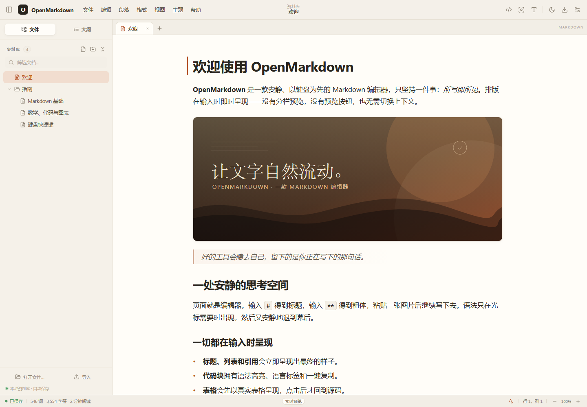
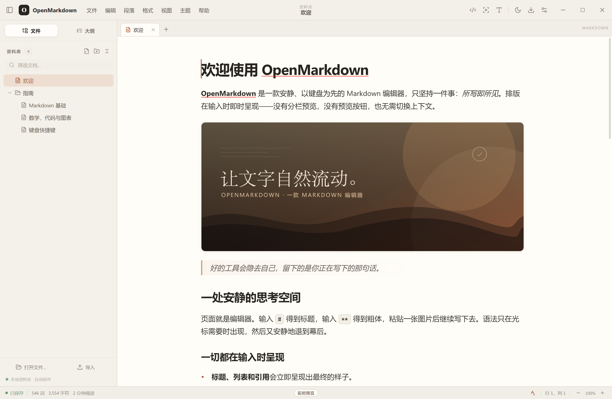

# OpenMarkdown

一个类似 Typora 的 Markdown 编辑器：所见即所得的行内实时预览、源代码模式、大纲、文件树、数学公式、Mermaid 流程图、表格、代码高亮、主题与多格式导出。

> **实时预览，而非分栏预览。** 排版在光标下方即时呈现，Markdown 标记只在需要编辑时出现。



## 快速开始

界面、菜单、对话框与内置示例文档均为简体中文。

```powershell
cd D:\code\inkwell
npm install
npm run dev
```

打开 <http://127.0.0.1:5180>。生产构建：

```powershell
npm run build
npm run preview
```

## Windows 桌面版

已安装到 **`D:\develop_tools\OpenMarkdown`**，桌面和开始菜单中均有 **OpenMarkdown** 快捷方式。



- 安装包：`release/OpenMarkdown-Setup-1.0.0.exe`（下载目录中有副本）
- 使用系统原生打开、保存对话框，支持将 Markdown 文件保存回磁盘
- 桌面版与浏览器版共用同一套中文界面和本地资料库
- 安装包未签名，SmartScreen 可能提示“未知发布者”，选择“更多信息 → 仍要运行”即可
- 重新打包：`npm run dist:win`

## 功能

### 写作体验

- **实时预览**：标题、粗体、斜体、删除线、高亮、行内代码、链接、图片、引用、列表、任务列表、分隔线、脚注、YAML front matter。
- **表格**：渲染为真正的表格；点击进入源码编辑；悬浮工具栏可加行、加列、删除行列、调整对齐。
- **代码块**：语法高亮（JS/TS、Python、Rust、Go、Java、C/C++、HTML/CSS、JSON、SQL、YAML、XML、PHP、Vue、Markdown 等）、语言标签、一键复制。
- **数学公式**：KaTeX 行内与独立公式。
- **Mermaid**：流程图、时序图、甘特图等，自动跟随主题渲染。
- **内联 HTML**：`<kbd>`、`<mark>`、`<u>` 等常用标签直接渲染，点击回到源码。
- **目录**：输入 `[TOC]` 生成可点击的文档目录。
- **智能粘贴**：粘贴 HTML 自动转 Markdown；粘贴/拖入图片自动内嵌为 data URI。
- **查找替换**、拼写检查、撤销/重做、自动保存。

### 编辑模式

- **实时预览** / **源代码模式**（`Ctrl+/`）
- **专注模式**（`F8`）：只保留当前段落，其余变淡
- **打字机模式**（`F9`）：当前行始终靠近屏幕中心
- **全屏**、缩放（80%–160%）
- 命令面板（`Ctrl+Shift+P`），搜索并执行所有主要命令

### 文件与组织

- 本地资料库：文件夹、新建、重命名、复制、删除、搜索过滤
- 多标签页、关闭/切换、未保存指示
- 大纲面板：跟随光标高亮当前章节，点击跳转
- **打开真实 `.md` 文件**并通过 `Ctrl+S` 写回磁盘（Chromium File System Access）
- 导入 Markdown 文件 / 拖入侧边栏导入，自动保存
- 导出 **HTML / PDF（打印）/ Word (.doc) / Markdown**，支持复制为 HTML

### 外观

6 套主题：OpenMarkdown、GitHub、午夜、Nord、Vue、棕褐。可调字体（无衬线/衬线/系统）、字号、行高、内容宽度、编辑器缩放。所有设置与文档保存在本地浏览器。

## 快捷键

| 操作 | 快捷键 |
| --- | --- |
| 新建 / 打开 / 保存 | `Ctrl N` / `Ctrl O` / `Ctrl S` |
| 导出 | `Ctrl Shift S` |
| 关闭标签 | `Ctrl W` |
| 粗体 / 斜体 / 行内代码 | `Ctrl B` / `Ctrl I` / `Ctrl E` |
| 链接 | `Ctrl K` |
| 删除线 / 高亮 | `Ctrl Shift X` / `Ctrl Shift H` |
| 标题 1–6 / 正文 | `Ctrl 1` … `Ctrl 6` / `Ctrl 0` |
| 引用 | `Ctrl Shift Q` |
| 代码块 / 数学块 / 表格 | `Ctrl Shift 反引号` / `Ctrl Shift M` / `Ctrl Alt T` |
| 查找 / 替换 | `Ctrl F` / `Ctrl H` |
| 源代码模式 | `Ctrl /` |
| 专注 / 打字机 | `F8` / `F9` |
| 侧边栏 | `Ctrl Shift L` |
| 命令面板 | `Ctrl Shift P` |
| 缩放 | `Ctrl =` / `Ctrl -` |

> 浏览器会保留 `Ctrl+N`、`Ctrl+W`、`Ctrl+T` 等部分组合键；不可用时请使用菜单。菜单中的命令始终可用。

## 技术栈

- **React 18 + TypeScript + Vite**
- **CodeMirror 6**：编辑器内核
- **@lezer/markdown + GFM**：Markdown 语法树
- **KaTeX**：数学公式
- **Mermaid**：图表
- **markdown-it + highlight.js**：导出渲染
- **DOMPurify**：HTML 清洗
- **Zustand**：状态与本地持久化
- **Turndown**：富文本粘贴转 Markdown

## 目录结构

```
src/
  editor/          CodeMirror 编辑器、实时预览装饰、组件、命令
  components/      标题栏、侧边栏、标签栏、设置/导出/链接弹窗
  store/           文档树、设置、持久化
  lib/             Markdown 解析、导出、文件操作
  styles/          主题 token、界面、编辑器样式
electron/           Electron 主进程与原生文件桥接
build/              应用图标与打包资源
```

## 说明与边界

- 侧边栏的文件树是应用内资料库，不会自动监视操作系统中的文件夹；桌面版打开单个文件后可保存回原路径。
- 桌面版数据保存在 `%APPDATA%\OpenMarkdown`，卸载时会保留。
- PDF 导出通过系统打印对话框完成，请选择“另存为 PDF”。
- 导出的 HTML 通过 CDN 加载 KaTeX 字体；离线打开时公式排版会退化为系统字体，内容不受影响。
- EPUB、LaTeX 等需要额外排版引擎的格式不在当前范围内。

---

用纯文本写作，让工具退到句子后面。
